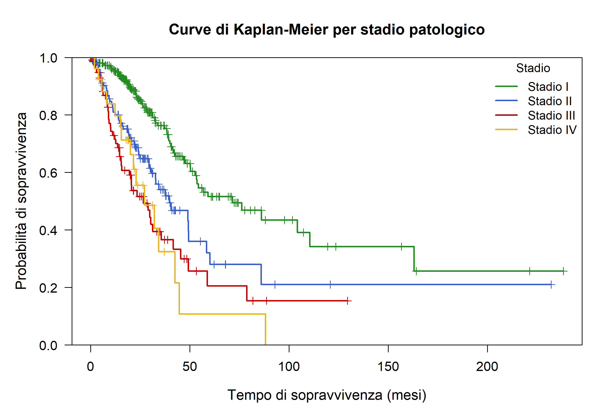

# Tumor Hypoxia and Overall Survival in Lung Adenocarcinoma

**TCGA-LUAD PanCancer Atlas · Survival analysis · R · Reproducible research**

This project examines whether gene-expression-based tumor hypoxia signatures are associated with overall survival in lung adenocarcinoma, after accounting for major clinical characteristics. It reproduces a 2026 academic study using authentic cBioPortal datasets and a carefully documented reimplementation of the original R analyses.

> **Status: private, end-to-end computational checks passed.** Source-data SHA-256 verification, cohort reconstruction, independent Python survival/Cox checks and the full reconstructed R pipeline passed on GitHub Actions (R 4.4.1, Python 3.11). [View the successful run](https://github.com/Salvatore-Megna/tcga-luad-hypoxia-survival/actions/runs/41726080460). Historical R source code was not recovered; this is a documented, independently checked reimplementation. Some detailed diagnostics still require comparison with historical report values before public release.

## At a glance

| Component | Detail |
|---|---|
| Source | [TCGA-LUAD (PanCancer Atlas)](https://www.cbioportal.org/study/summary?id=luad_tcga_pan_can_atlas_2018) |
| Data | Three authentic cBioPortal files; SHA-256 verified against DataHub Git LFS |
| Cohort | 566 original patients → 505 complete outcomes → 501 with time > 0 → **485 complete cases** |
| Events | 177 deaths; 308 censored observations |
| Biomarkers | Buffa, Ragnum and Winter hypoxia scores (expression-derived signatures) |
| Primary methods | Kaplan–Meier, log-rank, multivariable Cox regression and PH checks |
| Software | R (`survival`, `ggplot2`) and Python for independent validation |

## Main findings

- Observed median overall survival in the original report: **49.1 months**.
- Overall survival estimates at 12, 36 and 60 months: **0.875, 0.615 and 0.392**, independently replicated from the raw data.
- Stage is associated with survival (log-rank **p < 0.001**).
- In the multivariable Cox model, an increase of 10 units in Buffa Hypoxia Score corresponds to an estimated HR of **1.117** (95% CI **1.036–1.206**) in the historical report; the HR is independently replicated from the authentic data.
- The original report found evidence against proportional hazards in the standard model (global Schoenfeld **p = 0.016**) but not in the model stratified jointly by sex and stage (**p = 0.461**). The reconstructed R workflow now **runs both Schoenfeld diagnostics successfully** and exports their tables; equality of these detailed p-values with the historical values has **not yet been separately asserted**.



*Original figure from the recovered Overleaf study; `outputs/` will contain separately regenerated charts after an R run.*

## Methodology

Clinical and molecular data are joined **one-to-one by `PATIENT_ID`**. We retain complete outcomes with positive follow-up and apply complete-case selection on the analysis covariates. Stages IA/IB, IIA/IIB and IIIA/IIIB are grouped as I, II and III; IV remains IV.

**Important reconstruction detail:** the exact reported Cox estimates are reproduced by defining histology from the original **ICD-O-3 morphology codes**: `8140/3` = *NOS*, `8255/3` = *Mixed*, and all others = *Other*. Grouping by the sample-level `TUMOR_TYPE` description instead produces materially different estimates. Both standard and sex × stage-stratified Cox models use **Efron ties** and rescale age and Buffa score per 10 units.

This is an **observational association study**, not a clinical prediction tool and not evidence of causation. Hypoxia scores are gene-expression-derived signatures, not direct tumor oxygen measurements. The smaller stage-IV and stratified subgroups warrant caution.

## Reproduce the analysis

From the repository root (R 4.4+, Python 3.11+):

```bash
Rscript -e 'install.packages(c("survival", "ggplot2"), repos="https://cloud.r-project.org")'
Rscript scripts/run_all.R
```

All newly computed figures and CSVs are written to `outputs/` (not tracked by Git). The central pipeline recreates the cohort, descriptives, KM curves, log-rank comparison, both Cox models, PH diagnostics, martingale-residual plots and illustrative prognostic profiles. It raises an error if numerical benchmarks do not match.

Independent checks that have **already been run successfully** in Python:

```bash
python -m unittest discover -s tests -p 'test_*.py' -v
python -m pip install -r requirements-validation.txt
python tests/independent_cox_check.py
```

The first command verifies the exact source hashes, joins and sample flow without extra Python dependencies. The second numerical check uses `statsmodels` as an independent implementation of the Cox partial likelihood. All three jobs (data integrity, independent Python modeling and full R reconstruction) have **passed in [GitHub Actions](https://github.com/Salvatore-Megna/tcga-luad-hypoxia-survival/actions/runs/41726080460)**. The R job runs the complete workflow and the numerical benchmark assertions.

## Research report and provenance

The [original research report](report/report.pdf) is included as a compiled 17-page PDF. Its [LaTeX source](report/main.tex) comes from the recovered Overleaf project; the only deliberate adjustment in the repository copy is changing `\graphicspath` from `grafici_report/` to `figures/`. The source exactly as recovered is preserved in [`docs/original_overleaf_source.tex`](docs/original_overleaf_source.tex). The compiled document contains the **same normalized text** as the original PDF; spacing in tables can differ slightly because of the build environment.

Most original R scripts were not recovered. The code under `R/` and `scripts/` is **newly reconstructed** to reproduce the archived methods and measurements; it must not be represented as the historical source. See [provenance, validation and limitations](docs/PROVENANCE_AND_VALIDATION.md).

## Repository layout

```text
R/                     Five analysis modules (reconstructed R)
scripts/run_all.R      One command to run the whole workflow
tests/                 Input checks, independent Cox validation, R benchmarks
data/raw/               Official cBioPortal clinical and hypoxia source tables
report/                 Compiled report, LaTeX and original figures
docs/                   Source provenance and test status
.github/workflows/      Python and R checks configured for GitHub Actions
outputs/                Locally generated artifacts (gitignored)
```

## Data attribution and licensing

Data source: TCGA Research Network via [cBioPortal DataHub](https://github.com/cBioPortal/datahub/tree/master/public/luad_tcga_pan_can_atlas_2018), study `luad_tcga_pan_can_atlas_2018`. The source study includes a [data use notice](https://github.com/cBioPortal/datahub/blob/master/public/luad_tcga_pan_can_atlas_2018/LICENSE) warning that TCGA-derived data may be preliminary and subject to revision. No license for the author's separate R code/report has been chosen. **Before changing this repository to public**, review source-data redistribution conditions and choose appropriate licensing for new code, report and figures.
